# AURIX Motor Driver Firmware — GaN-FET PMSM Test Bench

Field-Oriented Control (FOC) firmware for a **GaN-FET three-phase inverter** driving a **PMSM**, running on an
**Infineon AURIX™ TC4D7** (KIT_TC4D7_LITE) multicore microcontroller.

The firmware runs a closed-loop d/q current controller synchronised to a center-aligned 40 kHz PWM, uses a
1200-line incremental encoder decoded fully in hardware, and streams every control-cycle sample over
Ethernet/UDP for live plotting in PlotJuggler. Controller gains and current set-points can be tuned live from
**OneEye** over DAP while the motor is running.

> **Status (2026-07-27):** closed-loop torque-mode FOC is working on hardware, with live tuning via OneEye and
> full-rate telemetry. Switching frequency was recently raised to 40 kHz. See [Project status](#project-status).

---

## Table of contents

- [System overview](#system-overview)
- [Hardware](#hardware)
- [Multicore architecture](#multicore-architecture)
- [Control-cycle timing](#control-cycle-timing)
- [FOC signal chain](#foc-signal-chain)
- [Drive state machine](#drive-state-machine)
- [Current & voltage sensing (TMADC)](#current--voltage-sensing-tmadc)
- [Encoder & rotor-angle calibration](#encoder--rotor-angle-calibration)
- [Live tuning with OneEye (DAP)](#live-tuning-with-oneeye-dap)
- [Telemetry pipeline (UDP → PlotJuggler)](#telemetry-pipeline-udp--plotjuggler)
- [Repository layout](#repository-layout)
- [Configuration reference](#configuration-reference)
- [Build, flash & run](#build-flash--run)
- [Development history](#development-history)
- [Project status](#project-status)

---

## System overview

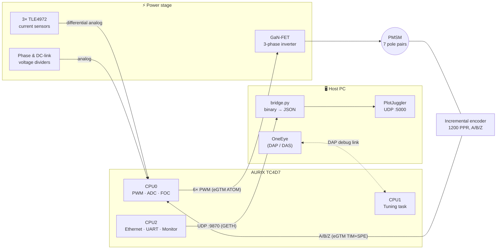

---

## Hardware

| Item | Details |
|---|---|
| MCU board | Infineon **KIT_TC4D7_LITE** (AURIX TC4Dx, 6 TriCore CPUs) |
| Power stage | GaN-FET 3-phase half-bridge inverter, 75 ns dead time (rise & fall) |
| Current sensing | 3× **TLE4972** coreless Hall sensors, differential outputs (VOUTP/VOUTN), ±30 A range |
| Voltage sensing | Va, Vb, Vc phase dividers + Vdc DC-link divider |
| Position sensor | Incremental encoder, 1200 PPR → 4800 counts/rev (x4), with Z index |
| Motor | PMSM, 7 pole pairs, Rs ≈ 0.25 Ω, Ls ≈ 120 µH (nominal values in `FOC.h`) |
| Ethernet PHY | DP83825I (RMII) on GETH0 |
| User I/O | On-board button (start/stop), LEDs, debug GPIO |

### Pin map (main signals)

| Function | Pin | Peripheral |
|---|---|---|
| Phase U HS / LS | P20.8 / P20.9 | eGTM ATOM0 CH0 / CH0N |
| Phase V HS / LS | P20.10 / P20.11 | eGTM ATOM0 CH1 / CH1N |
| Phase W HS / LS | P20.12 / P20.13 | eGTM ATOM0 CH2 / CH2N |
| Encoder B / A / Z | P00.10 / P00.11 / P00.12 | eGTM TIM0 CH1 / CH2 / CH3 → SPE0 |
| UART | ASCLIN14 | 576 000 baud |

---

## Multicore architecture

Work is split across three of the six TriCore CPUs so that the hard real-time control loop on CPU0 is never
disturbed by communication.

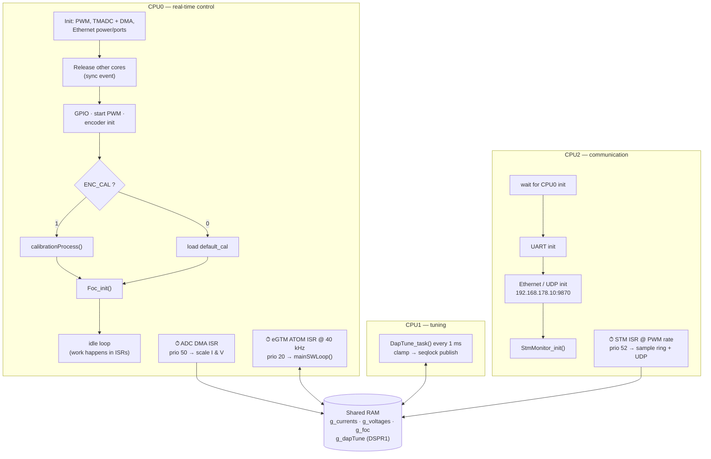

| Core | Role | Periodic activity |
|---|---|---|
| **CPU0** | PWM, ADC, encoder, FOC, protection, state machine | ATOM ISR @ 40 kHz, ADC/DMA ISR @ 40 kHz |
| **CPU1** | Live parameter validation (OneEye) | `DapTune_task()` every 1 ms |
| **CPU2** | Ethernet/UDP, UART, telemetry streaming | STM ISR @ 40 kHz, Ethernet service every 1 ms |
| CPU3–5 | Unused (watchdog disabled, idle) | — |

---

## Control-cycle timing

PWM is **center-aligned at 40 kHz** (Tₛ = 25 µs). The ADC is hardware-triggered at the PWM valley, so all 10
channels are frozen at the same instant in the middle of the zero vector, where phase currents equal their
average value.

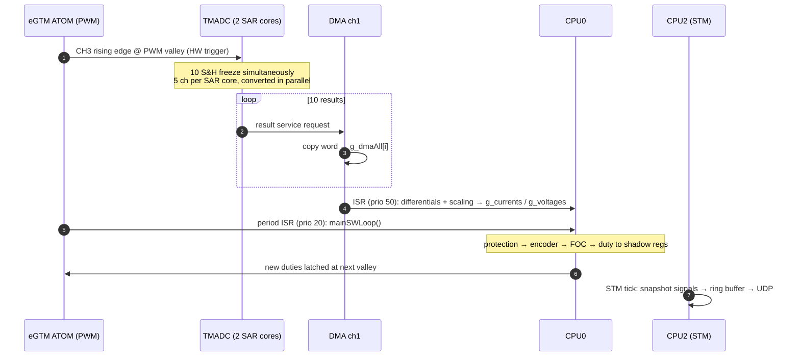

The FOC also compensates for the PWM transport delay: the output voltage vector is rotated forward by
`ωe · 1.5 · Tₛ` (0.5 Tₛ to shadow-load + 1.0 Tₛ averaging) so it lands where the rotor *will* be.

---

## FOC signal chain

Torque-mode FOC (current control only, no speed loop yet). Angle convention: `uint32`, one **electrical**
revolution = 2³², matching the encoder-calibration fixed-point format so no conversion is needed.

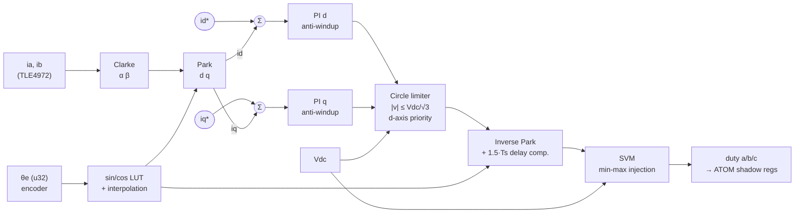

Key implementation details (`UserLibs/Control/FOC.c`):

- **Transforms:** amplitude-invariant Clarke/Park; `ic = −(ia + ib)`.
- **PI controllers:** forward-Euler integrator with clamping anti-windup; output limits are updated every
  cycle from the available voltage.
- **Voltage limit:** circle limiter with d-axis priority keeps SVM in its linear range (|v| ≤ Vdc/√3).
- **SVM:** min-max zero-sequence injection, 0.5 duty = zero vector.
- **Forced-angle mode:** used by the encoder alignment routine (open-loop vector at a commanded angle).
- **Default gains:** `Kp = 0.3`, `Ki = 0.4`, overridable at runtime from OneEye.

---

## Drive state machine

`mainSWLoop()` runs in the 40 kHz PWM ISR on CPU0. A software over-current guard (|ia|, |ib|, |ic| > 30 A)
runs *before* the state machine on every cycle and forces the `protection` state.

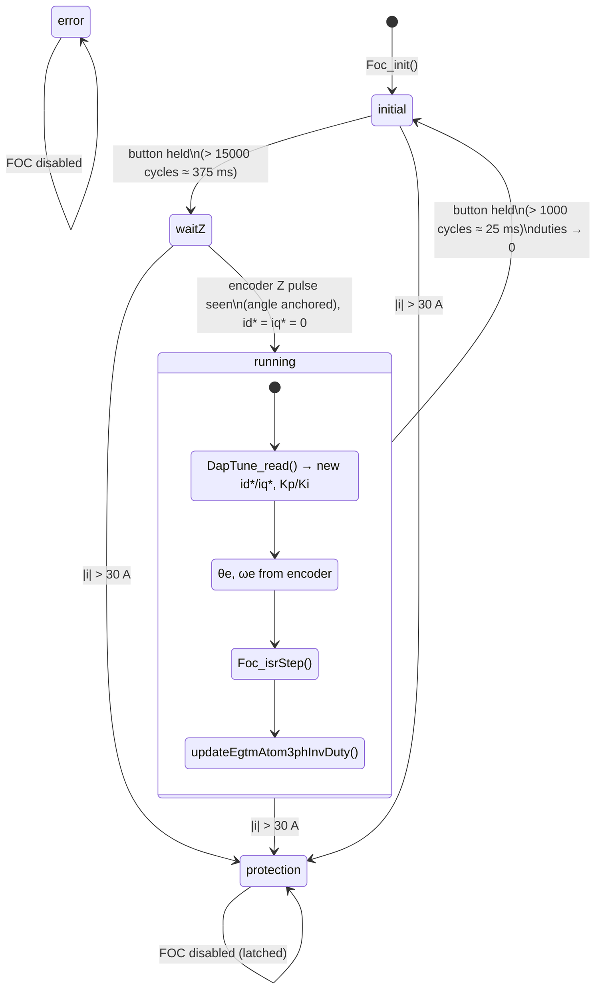

> The `protection` state is latched — a reset is required to leave it.

---

## Current & voltage sensing (TMADC)

All 10 analog channels belong to **one TMADC group with one hardware trigger**. Each channel has its own
sample-and-hold capacitor, so the sampling instant is identical (zero skew) for currents and voltages.

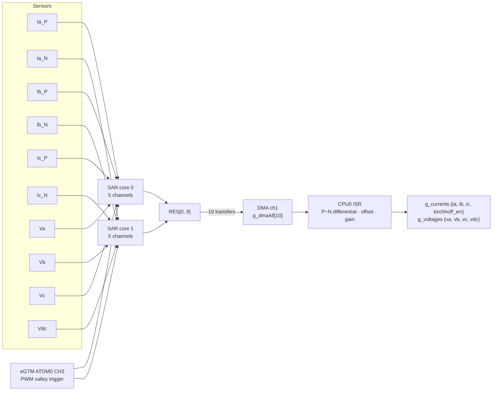

- Currents are computed as the **difference of the TLE4972 P and N outputs**, which rejects common-mode noise.
- `kirchhoff_err = ia + ib + ic` is kept as a sensor-health indicator (should stay ≈ 0 A).
- Offset/gain calibration was done on the bench (see commits *"calibrated adc"* and *"voltage calibrations"*).
  `current calibration.xml` is the PlotJuggler layout used for that work.

---

## Encoder & rotor-angle calibration

The TC4Dx eGTM has no MCS/ARU/DPLL, so the encoder is decoded with **TIM0 + SPE0** (Sensor Pattern
Evaluation): a hardware x4 quadrature counter with illegal-transition detection — zero CPU load.

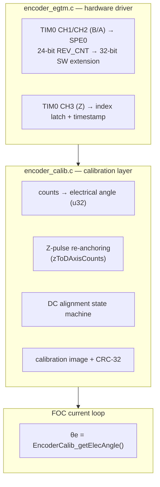

**Alignment procedure** (only when `ENC_CAL = 1`; otherwise the stored `default_cal` is loaded):

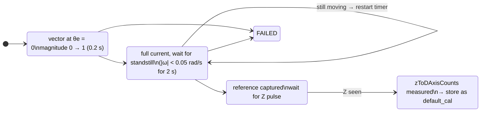

At run time the drive waits in `waitZ` until the first index pulse, then the electrical angle is absolute and
FOC can start.

---

## Live tuning with OneEye (DAP)

OneEye reads/writes MCU RAM directly over DAP while the CPUs run. Because it writes one 32-bit word at a time,
a **staging → validate → publish** scheme guarantees the controller never sees a half-updated parameter set.

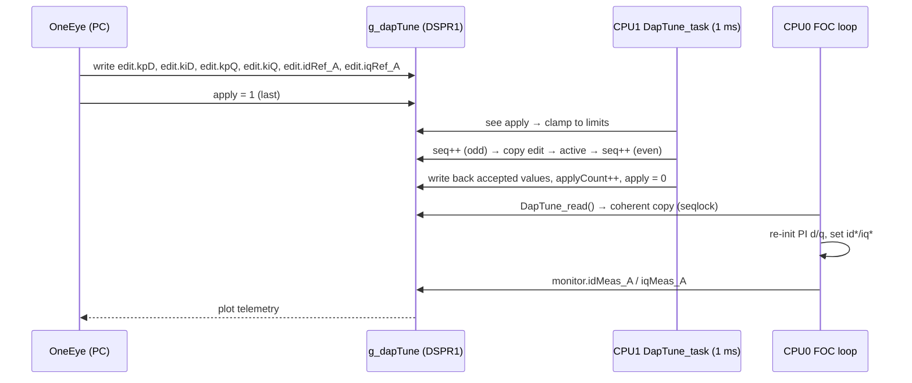

Safety clamps applied by CPU1: `0 ≤ Kp ≤ 100 V/A`, `0 ≤ Ki ≤ 50 000 V/(A·s)`, `|id*|, |iq*| ≤ 30 A`.

---

## Telemetry pipeline (UDP → PlotJuggler)

CPU2 samples the motor signals on every PWM period (STM timer) into a 512-entry lock-free ring buffer and
ships them over UDP. Two formats are available (`MON_USE_BINARY_BULK` in `Stm_Monitor.h`):

| Mode | Format | Notes |
|---|---|---|
| **Binary bulk** (default) | `"MON1"` header + packed `MonSample[]`, auto-fit to MTU | full rate, ~4× less bandwidth, needs `bridge.py` |
| JSON | `{"t":…, "ia":…, …}` per sample | direct to PlotJuggler, lower throughput |

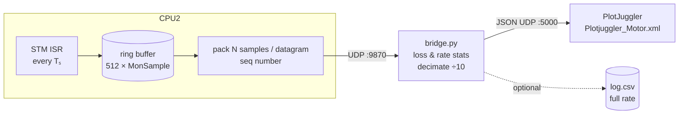

Signals are defined in **one X-macro list** (`MON_SIGNAL_LIST` in `Stm_Monitor.h`):

| ia | ib | ic | va | vb | vc | vdc | id | iq | theta | speed | AUX1 |
|---|---|---|---|---|---|---|---|---|---|---|---|

Packet layout:

```
┌──────────┬──────────┬──────────┬────────────┬─────────────────────────────────────────────┐
│ magic u32│ seq  u32 │ count u16│ ssize u16  │ count × { t_us u32 | 12 × float32 | status }│
│ "MON1"   │          │          │            │                                             │
└──────────┴──────────┴──────────┴────────────┴─────────────────────────────────────────────┘
```

> To add a signal: extend `MON_SIGNAL_LIST`, reflash, then append the same name to `NAMES` in `bridge.py`.
> The bridge detects a sample-size mismatch and warns instead of mis-decoding.

---

## Repository layout

```
AURIX_Motor_Driver_FW/
├── Cpu0_Main.c … Cpu5_Main.c      # per-core entry points (CPU0/1/2 active)
├── UserLibs/
│   ├── Configurations.h           # PWM frequency, dead time, pole pairs, ENC_CAL
│   ├── Control/
│   │   ├── FOC.c/.h               # transforms, PI, limiter, SVM, FOC step
│   │   └── Control_Loops.c/.h     # mainSWLoop(): protection + state machine
│   ├── Peripherals/
│   │   ├── EGTM_ATOM_3_Phase_Inverter_PWM.c/.h  # complementary PWM + dead time, 40 kHz ISR
│   │   ├── Adc_MotorSense*.c/.h   # 10-ch TMADC + DMA, synchronous sampling
│   │   ├── encoder_egtm.c/.h      # TIM0 + SPE0 hardware quadrature decoder
│   │   ├── encoder_calib.c/.h     # electrical angle, Z anchoring, alignment
│   │   ├── Eth_Core.c/.h          # minimal Ethernet + IPv4/UDP on GETH0 (CPU2)
│   │   ├── EthernetLib.c/.h       # PHY/port preparation done on CPU0
│   │   ├── ASCLIN_UART.c/.h       # UART on CPU2
│   │   └── GPIO_LED_Button.c/.h   # LEDs, button, debug pins
│   └── Monitor/
│       ├── Stm_Monitor.c/.h       # STM-driven telemetry sampler + UDP sender
│       ├── Monitor_Json.c/.h      # malloc-free JSON serializer
│       ├── dap_tune.c/.h          # OneEye live tuning (seqlock)
│       └── UserFunctions.c/.h     # helpers (Delay, …)
├── Boards/                        # KIT_TC4D7_LITE clock & pin definitions
├── Configurations/                # iLLD startup (SSW) configuration
├── External/                      # PDL (GETH, HSPHY, MCMCAN…) and PHY drivers
├── Libraries/                     # Infineon iLLD for TC4xx
├── Lcf_Gcc_Tricore_Tc.lsl         # linker script (g_dapTune → DSPR1)
├── bridge.py                      # binary UDP → PlotJuggler JSON bridge
├── Plotjuggler_Motor.xml          # PlotJuggler layout: motor run
└── current calibration.xml        # PlotJuggler layout: ADC calibration
```

---

## Configuration reference

| Parameter | Value | Location |
|---|---|---|
| `PWM_FREQUENCY` | 40 kHz (Tₛ = 25 µs) | `UserLibs/Configurations.h` |
| `PWM_DeadTime_Rise/Fall` | 75 ns | `UserLibs/Configurations.h` |
| `MotorPolePairs` | 7 | `UserLibs/Configurations.h` |
| `ENC_CAL` | 0 = use stored calibration, 1 = run alignment | `UserLibs/Configurations.h` |
| `ENC_PULSES_PER_REV` | 1200 (4800 counts x4) | `encoder_egtm.h` |
| `ENC_TIM_FILTER_TICKS` | 50 | `encoder_egtm.h` |
| `FOC_RS_OHM` / `FOC_LS_H` | 0.25 Ω / 120 µH | `FOC.h` |
| `FOC_I_MAX_A` | 30 A (software trip) | `FOC.h` |
| `FOC_FC_HZ` | 4.5 kHz target current-loop bandwidth | `FOC.h` |
| MCU IP / port | 192.168.178.10 : 9870 | `Eth_Core.c` |
| Host IP / port | 192.168.178.100 : 9870 | `Eth_Core.c` |
| UART baud | 576 000 | `ASCLIN_UART.c` |
| `MON_USE_BINARY_BULK` | 1 | `Stm_Monitor.h` |

Interrupt priorities:

| ISR | Core | Priority |
|---|---|---|
| eGTM ATOM period (control loop) | CPU0 | 20 |
| ADC DMA complete | CPU0 | 50 |
| STM telemetry | CPU2 | 52 |
| ASCLIN14 TX/RX | CPU2 | — |

---

## Build, flash & run

**Toolchain:** AURIX Development Studio (ADS) with the TriCore GCC toolchain, iLLD for TC4xx.

1. Import the project into ADS and build the `TriCore Debug (GCC)` configuration.
2. Flash/debug with the `Motor_Driver TriCore Debug (GCC).launch` configuration.
3. Configure the PC network adapter to `192.168.178.100/24` and connect it to the board.
4. Start the telemetry bridge and PlotJuggler:

   ```bash
   python bridge.py
   ```

   In PlotJuggler start the **UDP server** (JSON, port 5000) and load `Plotjuggler_Motor.xml`.
5. (Optional) Attach **OneEye**, add a watch on `g_dapTune`, and use `edit.*` + `apply = 1` to tune.
6. **Run the motor:**
   - power the inverter, hold the board button (~0.4 s) → state `waitZ`;
   - turn the shaft until the encoder index passes → state `running` with id* = iq* = 0;
   - set `iq*` (torque) and gains from OneEye;
   - hold the button again (~25 ms) to stop.

> ⚠️ The 30 A software guard is not a substitute for a hardware over-current trip. Bring the motor up with low
> current limits and a current-limited DC supply.

---

## Development history

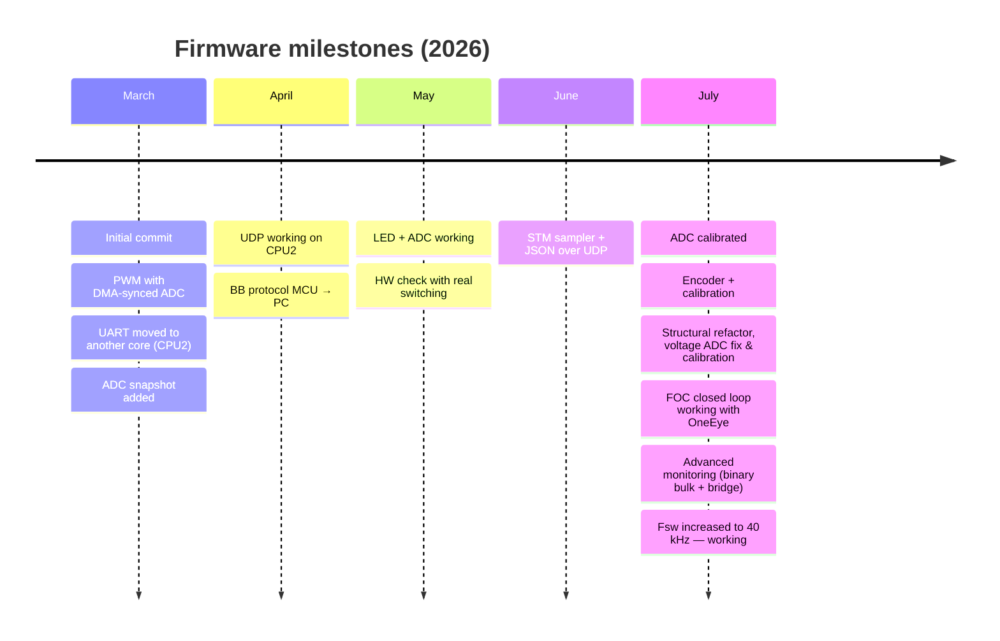

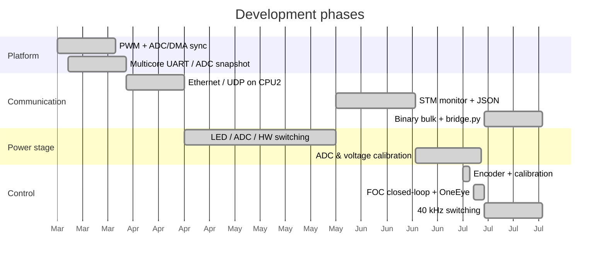

---

## Project status

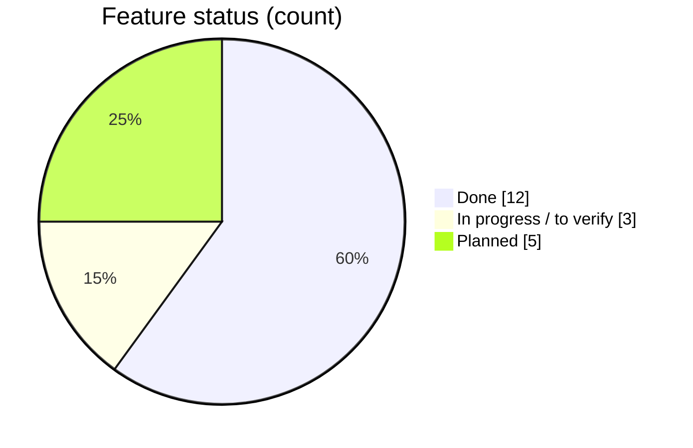

### ✅ Done

- [x] Complementary 3-phase PWM on eGTM ATOM with 75 ns dead time, 40 kHz center-aligned
- [x] 10-channel synchronous TMADC sampling, DMA transfer, single ISR
- [x] Differential TLE4972 current sensing, offset/gain calibration
- [x] Phase and DC-link voltage sensing with calibration
- [x] Hardware x4 encoder decoding on TIM0 + SPE0, 32-bit position extension
- [x] Electrical-angle calibration with Z-pulse anchoring and DC alignment routine
- [x] Torque-mode FOC: Clarke/Park, PI with anti-windup, circle limiter, SVM, delay compensation
- [x] Drive state machine with button start/stop and software over-current protection
- [x] Ethernet/UDP stack on CPU2 (GETH0 + DP83825I)
- [x] Lossless full-rate telemetry (ring buffer, binary bulk, sequence/loss detection)
- [x] `bridge.py` → PlotJuggler with live link statistics and optional CSV logging
- [x] Live, coherent gain and set-point tuning from OneEye (seqlock on CPU1)

### 🔧 In progress / to verify

- [ ] Re-tune current-loop gains for 40 kHz (defaults `Kp = 0.3`, `Ki = 0.4` vs. 4.5 kHz design target)
- [ ] Confirm motor parameters (Rs, Ls) by measurement — values in `FOC.h` are nominal
- [ ] Clean up stale comments that still refer to 100/200 kHz timing in `FOC.h` / `Adc_MotorSense*.{c,h}`

### 🗺️ Planned

- [ ] Speed (and position) outer loop on top of the current loop
- [ ] Hardware over-current / fault trip wired to PWM shutdown
- [ ] Store encoder calibration in DFLASH instead of a compiled-in `default_cal`
- [ ] Recoverable fault handling (clear `protection` without reset), use of the `error` state
- [ ] Enable watchdogs on active cores
